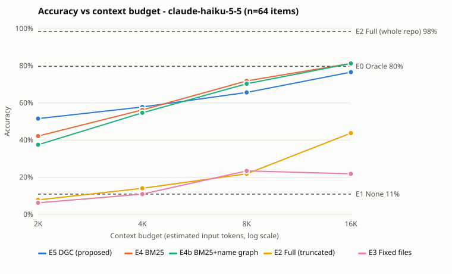
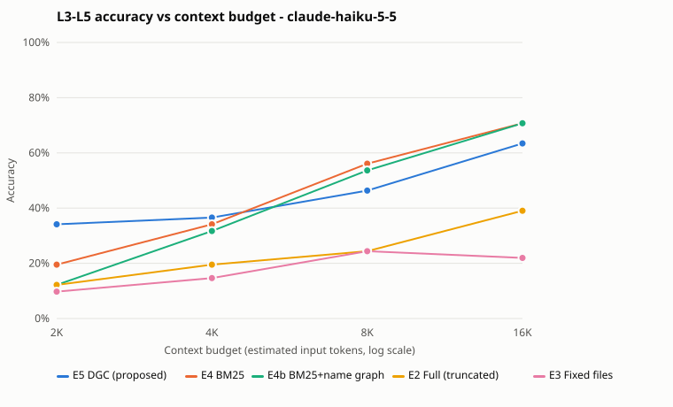
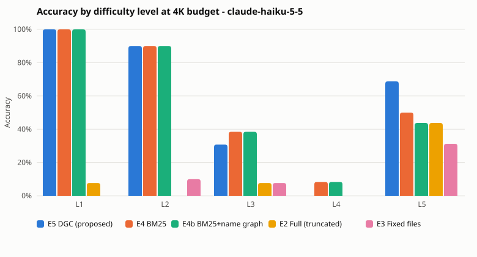
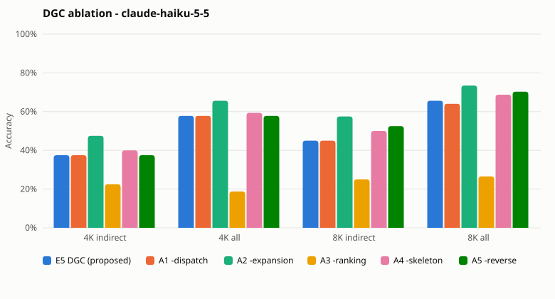
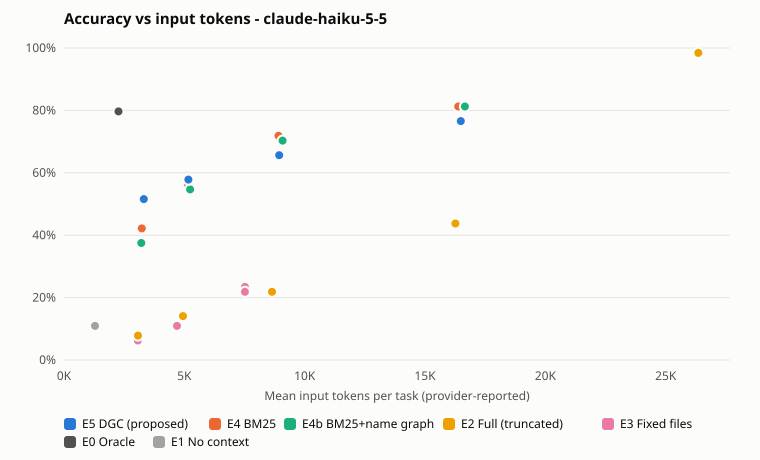

# Results - main_haiku-20261113-184053

- Created: 2026-11-13T18:40:53; dataset v1 (sha 5e550060fea81413); fixture 8da947b42b62564d; prompt p1; ccbench 1.0.0
- Providers (effective parameters): `{"claude-haiku-5-5": {"model": "haiku", "temperature": null, "seed": null, "unsupported": ["temperature", "seed"], "effort": null}}`
- Records: 2112 (ok 2112, errors 0); scored from raw responses with scorer s2

## Accuracy and cost per condition

| model | strategy | budget | n | acc % [95% CI] | L1 | L2 | L3 | L4 | L5 | ctx recall | evid. P | evid. R | est ctx tok | input tok | out tok | latency s | cost/task $ |
|---|---|---|---|---|---|---|---|---|---|---|---|---|---|---|---|---|---|
| claude-haiku-5-5 | bm25 | 2000 | 64 | 42.2 [30.9, 54.4] | 100.0 | 60.0 | 30.8 | 0.0 | 25.0 | 44.4 | 60.4 | 39.2 | 1970 | 3232 | 658 | 6.7 | 0.0010 |
| claude-haiku-5-5 | bm25 | 4000 | 64 | 56.2 [44.1, 67.7] | 100.0 | 90.0 | 38.5 | 8.3 | 50.0 | 59.7 | 70.6 | 50.6 | 3949 | 5155 | 764 | 6.9 | 0.0014 |
| claude-haiku-5-5 | bm25 | 8000 | 64 | 71.9 [59.9, 81.4] | 100.0 | 100.0 | 53.8 | 16.7 | 87.5 | 75.0 | 74.7 | 61.9 | 7906 | 8914 | 925 | 7.6 | 0.0022 |
| claude-haiku-5-5 | bm25 | 16000 | 64 | 81.2 [70.0, 88.9] | 100.0 | 100.0 | 69.2 | 33.3 | 100.0 | 89.5 | 81.0 | 69.2 | 15802 | 16380 | 931 | 5.5 | 0.0037 |
| claude-haiku-5-5 | bm25_namegraph | 2000 | 64 | 37.5 [26.7, 49.7] | 100.0 | 60.0 | 7.7 | 0.0 | 25.0 | 45.8 | 56.1 | 37.3 | 1968 | 3213 | 677 | 4.6 | 0.0009 |
| claude-haiku-5-5 | bm25_namegraph | 4000 | 64 | 54.7 [42.6, 66.3] | 100.0 | 90.0 | 38.5 | 8.3 | 43.8 | 60.9 | 69.9 | 49.3 | 3946 | 5239 | 773 | 5.9 | 0.0014 |
| claude-haiku-5-5 | bm25_namegraph | 8000 | 64 | 70.3 [58.2, 80.1] | 100.0 | 100.0 | 61.5 | 8.3 | 81.2 | 77.1 | 77.1 | 61.6 | 7903 | 9081 | 922 | 6.5 | 0.0021 |
| claude-haiku-5-5 | bm25_namegraph | 16000 | 64 | 81.2 [70.0, 88.9] | 100.0 | 100.0 | 69.2 | 41.7 | 93.8 | 91.0 | 80.6 | 70.0 | 15801 | 16655 | 947 | 7.6 | 0.0035 |
| claude-haiku-5-5 | dgc | 2000 | 64 | 51.6 [39.6, 63.4] | 100.0 | 60.0 | 30.8 | 0.0 | 62.5 | 63.9 | 73.1 | 54.5 | 1968 | 3317 | 691 | 6.4 | 0.0010 |
| claude-haiku-5-5 | dgc | 4000 | 64 | 57.8 [45.6, 69.1] | 100.0 | 90.0 | 30.8 | 0.0 | 68.8 | 74.8 | 77.1 | 60.9 | 3945 | 5167 | 762 | 5.0 | 0.0014 |
| claude-haiku-5-5 | dgc | 8000 | 64 | 65.6 [53.4, 76.1] | 100.0 | 100.0 | 46.2 | 8.3 | 75.0 | 86.1 | 79.3 | 65.9 | 7900 | 8943 | 881 | 6.1 | 0.0022 |
| claude-haiku-5-5 | dgc | 16000 | 64 | 76.6 [64.9, 85.3] | 100.0 | 100.0 | 76.9 | 16.7 | 87.5 | 96.1 | 81.5 | 69.7 | 15802 | 16489 | 993 | 6.6 | 0.0038 |
| claude-haiku-5-5 | dgc_no_dispatch | 4000 | 64 | 57.8 [45.6, 69.1] | 100.0 | 90.0 | 30.8 | 0.0 | 68.8 | 72.2 | 78.4 | 60.5 | 3945 | 5161 | 748 | 5.2 | 0.0012 |
| claude-haiku-5-5 | dgc_no_dispatch | 8000 | 64 | 64.1 [51.8, 74.7] | 100.0 | 90.0 | 53.8 | 8.3 | 68.8 | 81.6 | 80.8 | 63.0 | 7897 | 8914 | 793 | 5.1 | 0.0021 |
| claude-haiku-5-5 | dgc_no_expansion | 4000 | 64 | 65.6 [53.4, 76.1] | 100.0 | 90.0 | 61.5 | 8.3 | 68.8 | 68.4 | 78.6 | 59.7 | 3948 | 5148 | 812 | 5.3 | 0.0013 |
| claude-haiku-5-5 | dgc_no_expansion | 8000 | 64 | 73.4 [61.5, 82.7] | 100.0 | 100.0 | 61.5 | 8.3 | 93.8 | 83.3 | 81.7 | 69.8 | 7906 | 8917 | 908 | 5.4 | 0.0020 |
| claude-haiku-5-5 | dgc_no_ranking | 4000 | 64 | 18.8 [11.1, 30.0] | 23.1 | 0.0 | 15.4 | 0.0 | 43.8 | 24.2 | 40.5 | 21.4 | 3945 | 5038 | 709 | 4.7 | 0.0014 |
| claude-haiku-5-5 | dgc_no_ranking | 8000 | 64 | 26.6 [17.3, 38.5] | 38.5 | 20.0 | 15.4 | 0.0 | 50.0 | 38.8 | 48.0 | 29.8 | 7886 | 8845 | 746 | 5.0 | 0.0021 |
| claude-haiku-5-5 | dgc_no_reverse | 4000 | 64 | 57.8 [45.6, 69.1] | 100.0 | 90.0 | 53.8 | 0.0 | 50.0 | 69.7 | 74.7 | 57.2 | 3945 | 5174 | 716 | 5.5 | 0.0013 |
| claude-haiku-5-5 | dgc_no_reverse | 8000 | 64 | 70.3 [58.2, 80.1] | 100.0 | 100.0 | 69.2 | 16.7 | 68.8 | 87.3 | 79.9 | 65.1 | 7897 | 8934 | 799 | 5.0 | 0.0021 |
| claude-haiku-5-5 | dgc_no_skeleton | 4000 | 64 | 59.4 [47.1, 70.5] | 100.0 | 90.0 | 38.5 | 0.0 | 68.8 | 75.6 | 77.3 | 61.6 | 3944 | 5167 | 708 | 5.1 | 0.0012 |
| claude-haiku-5-5 | dgc_no_skeleton | 8000 | 64 | 68.8 [56.6, 78.8] | 100.0 | 100.0 | 53.8 | 8.3 | 81.2 | 86.1 | 79.5 | 65.5 | 7900 | 8942 | 818 | 5.2 | 0.0014 |
| claude-haiku-5-5 | fixed | 2000 | 64 | 6.2 [2.5, 15.0] | 0.0 | 0.0 | 7.7 | 0.0 | 18.8 | 4.8 | 13.2 | 4.1 | 1942 | 3067 | 588 | 4.5 | 0.0009 |
| claude-haiku-5-5 | fixed | 4000 | 64 | 10.9 [5.4, 20.9] | 0.0 | 10.0 | 7.7 | 0.0 | 31.2 | 18.6 | 28.0 | 12.3 | 3694 | 4697 | 663 | 7.4 | 0.0013 |
| claude-haiku-5-5 | fixed | 8000 | 64 | 23.4 [14.7, 35.1] | 23.1 | 20.0 | 7.7 | 8.3 | 50.0 | 33.7 | 40.5 | 22.7 | 6870 | 7517 | 786 | 7.5 | 0.0019 |
| claude-haiku-5-5 | fixed | 16000 | 64 | 21.9 [13.5, 33.4] | 23.1 | 20.0 | 7.7 | 8.3 | 43.8 | 33.7 | 38.6 | 21.6 | 6870 | 7517 | 751 | 7.4 | 0.0010 |
| claude-haiku-5-5 | full | 2000 | 64 | 7.8 [3.4, 17.0] | 0.0 | 0.0 | 7.7 | 0.0 | 25.0 | 6.3 | 19.0 | 5.3 | 1972 | 3073 | 589 | 4.8 | 0.0009 |
| claude-haiku-5-5 | full | 4000 | 64 | 14.1 [7.6, 24.6] | 7.7 | 0.0 | 7.7 | 0.0 | 43.8 | 13.0 | 27.5 | 11.2 | 3862 | 4942 | 670 | 5.2 | 0.0013 |
| claude-haiku-5-5 | full | 8000 | 64 | 21.9 [13.5, 33.4] | 23.1 | 10.0 | 15.4 | 0.0 | 50.0 | 32.5 | 38.5 | 23.4 | 7889 | 8644 | 677 | 5.2 | 0.0021 |
| claude-haiku-5-5 | full | 16000 | 64 | 43.8 [32.3, 55.9] | 61.5 | 40.0 | 30.8 | 16.7 | 62.5 | 57.5 | 55.9 | 41.0 | 15722 | 16261 | 817 | 5.7 | 0.0037 |
| claude-haiku-5-5 | full | unbounded | 64 | 98.4 [91.7, 99.7] | 100.0 | 100.0 | 92.3 | 100.0 | 100.0 | 100.0 | 80.1 | 73.0 | 26320 | 26354 | 1095 | 6.2 | 0.0058 |
| claude-haiku-5-5 | none | unbounded | 64 | 10.9 [5.4, 20.9] | 15.4 | 10.0 | 7.7 | 0.0 | 18.8 | 0.0 | 1.6 | 0.8 | 0 | 1288 | 490 | 3.6 | 0.0005 |
| claude-haiku-5-5 | oracle | unbounded | 64 | 79.7 [68.3, 87.7] | 100.0 | 100.0 | 84.6 | 33.3 | 81.2 | 100.0 | 99.3 | 78.8 | 982 | 2266 | 743 | 4.6 | 0.0008 |

## Pre-registered hypotheses

### claude-haiku-5-5

- **H1a_2000** - supported_uncorrected_only (fails Holm): `{"comparison": "dgc - bm25 @2000, L3-L5", "n_items": 41, "acc_dgc": 0.3415, "acc_bm25": 0.1951, "diff": 0.1463, "ci95": [0.024390243902439025, 0.2682926829268293], "p_bootstrap": 0.04, "mcnemar": [7, 1, 0.0703125], "p_holm": 0.2}`
- **H1a_4000** - inconclusive: `{"comparison": "dgc - bm25 @4000, L3-L5", "n_items": 41, "acc_dgc": 0.3659, "acc_bm25": 0.3415, "diff": 0.0244, "ci95": [-0.14634146341463414, 0.17073170731707318], "p_bootstrap": 0.8827, "mcnemar": [6, 5, 1.0], "p_holm": 1.0}`
- **H1b** - supported: `{"comparison": "(dgc@2K - full@2K) - (dgc@16K - full@unbounded)", "n_items": 64, "gap_low": 0.4375, "gap_high": -0.2188, "diff": 0.6562, "ci95": [0.53125, 0.78125], "p_bootstrap": 0.0001, "p_holm": 0.0006}`
- **H2a** - not equivalent: `{"comparison": "acc(dgc | CR=1) - acc(bm25 | CR=1), pooled over budgets", "n_dgc_cr1": 141, "n_bm25_cr1": 101, "acc_dgc_cr1": 0.9362, "acc_bm25_cr1": 0.9604, "acc_dgc_cr_lt1": 0.2522, "acc_bm25_cr_lt1": 0.4129, "diff": -0.0242, "ci90": [-0.06958780984481427, 0.021136156168808373], "margin": 0.05}`
- **H2b** - supported: `{"comparison": "oracle-context error rate, L4-L5", "n": 28, "error_rate": 0.3929, "ci95": [0.23565451827580033, 0.575912739650937], "threshold": 0.15}`
- **H3a_4000** - refuted: `{"comparison": "dgc - dgc_no_dispatch @4000 (indirect vs direct items)", "diff_indirect": 0.0, "ci95_indirect": [0.0, 0.0], "diff_direct": 0.0, "ci95_direct": [-0.125, 0.125], "p_bootstrap_indirect": 1.0, "p_holm": 1.0}`
- **H3a_8000** - inconclusive: `{"comparison": "dgc - dgc_no_dispatch @8000 (indirect vs direct items)", "diff_indirect": 0.0, "ci95_indirect": [-0.1, 0.1], "diff_direct": 0.0417, "ci95_direct": [0.0, 0.125], "p_bootstrap_indirect": 1.0, "p_holm": 1.0}`
- **H3b** - inconclusive: `{"comparison": "distractor-confusion rate on look-alike items, bm25 vs dgc @2K+4K", "rate_bm25": 0.0517, "rate_dgc": 0.0, "bm25_only": 3, "dgc_only": 0, "p_mcnemar": 0.25, "p_holm": 1.0}`

## Other diagnostics

```json
{
  "flip_rate": null,
  "token_calibration": {
    "claude-haiku-5-5": {
      "n": 2112,
      "intercept_tokens": 560.5164421272639,
      "slope_actual_per_estimated": 0.9568209621744409
    }
  },
  "model_rank_agreement": {},
  "n_records": 2112,
  "n_ok": 2112,
  "n_errors": 0
}
```

## Charts






