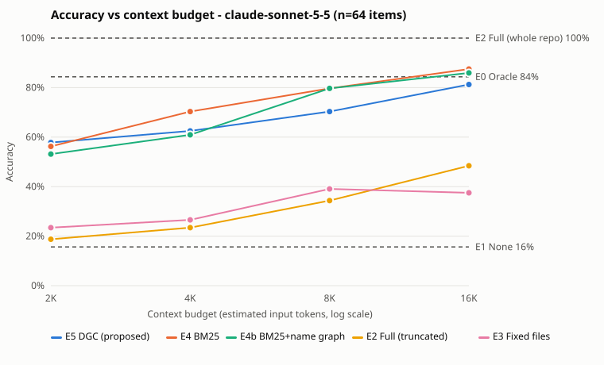
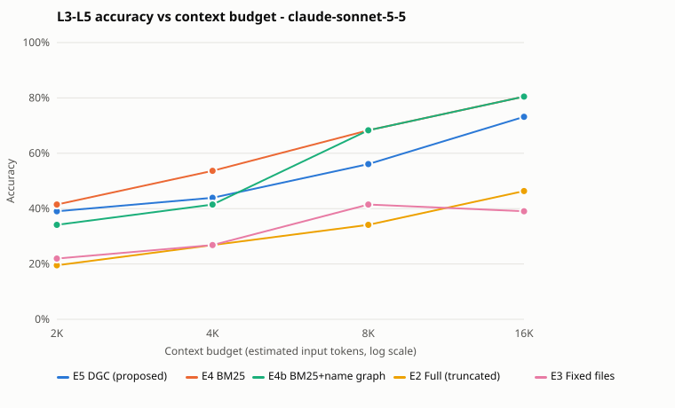
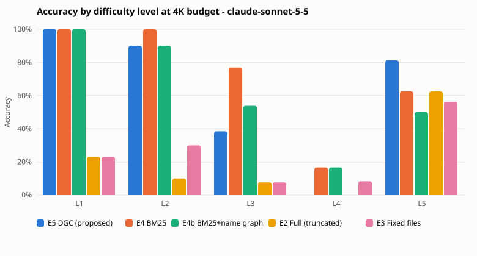
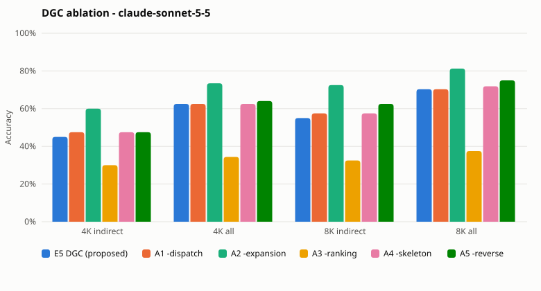
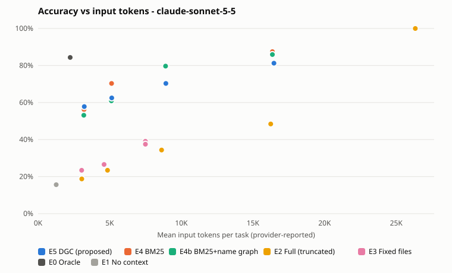

# Results - main_sonnet-20261113-184443

- Created: 2026-11-13T18:44:43; dataset v1 (sha 5e550060fea81413); fixture 8da947b42b62564d; prompt p1; ccbench 1.0.0
- Providers (effective parameters): `{"claude-sonnet-5-5": {"model": "sonnet", "temperature": null, "seed": null, "unsupported": ["temperature", "seed"], "effort": null}}`
- Records: 2112 (ok 2112, errors 0); scored from raw responses with scorer s2

## Accuracy and cost per condition

| model | strategy | budget | n | acc % [95% CI] | L1 | L2 | L3 | L4 | L5 | ctx recall | evid. P | evid. R | est ctx tok | input tok | out tok | latency s | cost/task $ |
|---|---|---|---|---|---|---|---|---|---|---|---|---|---|---|---|---|---|
| claude-sonnet-5-5 | bm25 | 2000 | 64 | 56.2 [44.1, 67.7] | 92.3 | 70.0 | 53.8 | 16.7 | 50.0 | 44.4 | 61.8 | 41.5 | 1970 | 3209 | 417 | 4.8 | 0.0168 |
| claude-sonnet-5-5 | bm25 | 4000 | 64 | 70.3 [58.2, 80.1] | 100.0 | 100.0 | 76.9 | 16.7 | 62.5 | 59.7 | 71.3 | 54.4 | 3949 | 5132 | 462 | 5.4 | 0.0248 |
| claude-sonnet-5-5 | bm25 | 8000 | 64 | 79.7 [68.3, 87.7] | 100.0 | 100.0 | 69.2 | 33.3 | 93.8 | 75.0 | 74.3 | 64.0 | 7906 | 8892 | 470 | 5.2 | 0.0397 |
| claude-sonnet-5-5 | bm25 | 16000 | 64 | 87.5 [77.2, 93.5] | 100.0 | 100.0 | 76.9 | 58.3 | 100.0 | 89.5 | 77.6 | 72.2 | 15802 | 16358 | 469 | 5.3 | 0.0691 |
| claude-sonnet-5-5 | bm25_namegraph | 2000 | 64 | 53.1 [41.1, 64.8] | 100.0 | 70.0 | 23.1 | 16.7 | 56.2 | 45.8 | 58.9 | 39.9 | 1968 | 3191 | 404 | 5.0 | 0.0159 |
| claude-sonnet-5-5 | bm25_namegraph | 4000 | 64 | 60.9 [48.7, 71.9] | 100.0 | 90.0 | 53.8 | 16.7 | 50.0 | 60.9 | 71.4 | 52.7 | 3946 | 5118 | 433 | 5.2 | 0.0234 |
| claude-sonnet-5-5 | bm25_namegraph | 8000 | 64 | 79.7 [68.3, 87.7] | 100.0 | 100.0 | 69.2 | 33.3 | 93.8 | 77.1 | 74.9 | 64.2 | 7903 | 8900 | 468 | 5.1 | 0.0377 |
| claude-sonnet-5-5 | bm25_namegraph | 16000 | 64 | 85.9 [75.4, 92.4] | 92.3 | 100.0 | 76.9 | 58.3 | 100.0 | 91.0 | 76.2 | 69.2 | 15801 | 16356 | 469 | 5.3 | 0.0653 |
| claude-sonnet-5-5 | dgc | 2000 | 64 | 57.8 [45.6, 69.1] | 100.0 | 80.0 | 38.5 | 0.0 | 68.8 | 63.9 | 69.0 | 55.5 | 1968 | 3226 | 396 | 4.9 | 0.0169 |
| claude-sonnet-5-5 | dgc | 4000 | 64 | 62.5 [50.3, 73.3] | 100.0 | 90.0 | 38.5 | 0.0 | 81.2 | 74.8 | 77.6 | 64.3 | 3945 | 5145 | 426 | 6.0 | 0.0248 |
| claude-sonnet-5-5 | dgc | 8000 | 64 | 70.3 [58.2, 80.1] | 92.3 | 100.0 | 61.5 | 8.3 | 87.5 | 86.1 | 78.7 | 68.1 | 7900 | 8921 | 425 | 5.9 | 0.0399 |
| claude-sonnet-5-5 | dgc | 16000 | 64 | 81.2 [70.0, 88.9] | 92.3 | 100.0 | 92.3 | 16.7 | 100.0 | 96.1 | 80.7 | 72.3 | 15802 | 16467 | 460 | 6.0 | 0.0705 |
| claude-sonnet-5-5 | dgc_no_dispatch | 4000 | 64 | 62.5 [50.3, 73.3] | 92.3 | 90.0 | 46.2 | 0.0 | 81.2 | 72.2 | 73.9 | 61.2 | 3945 | 5139 | 429 | 5.6 | 0.0209 |
| claude-sonnet-5-5 | dgc_no_dispatch | 8000 | 64 | 70.3 [58.2, 80.1] | 92.3 | 90.0 | 69.2 | 8.3 | 87.5 | 81.6 | 76.7 | 64.7 | 7897 | 8892 | 433 | 5.5 | 0.0383 |
| claude-sonnet-5-5 | dgc_no_expansion | 4000 | 64 | 73.4 [61.5, 82.7] | 92.3 | 100.0 | 69.2 | 16.7 | 87.5 | 68.4 | 74.3 | 61.2 | 3948 | 5126 | 454 | 5.2 | 0.0224 |
| claude-sonnet-5-5 | dgc_no_expansion | 8000 | 64 | 81.2 [70.0, 88.9] | 92.3 | 100.0 | 69.2 | 41.7 | 100.0 | 83.3 | 77.9 | 71.7 | 7906 | 9027 | 462 | 7.4 | 0.0345 |
| claude-sonnet-5-5 | dgc_no_ranking | 4000 | 64 | 34.4 [23.9, 46.6] | 46.2 | 30.0 | 15.4 | 16.7 | 56.2 | 24.2 | 40.5 | 22.7 | 3945 | 5088 | 434 | 7.4 | 0.0244 |
| claude-sonnet-5-5 | dgc_no_ranking | 8000 | 64 | 37.5 [26.7, 49.7] | 53.8 | 30.0 | 15.4 | 16.7 | 62.5 | 38.8 | 51.1 | 33.4 | 7886 | 8955 | 454 | 7.0 | 0.0398 |
| claude-sonnet-5-5 | dgc_no_reverse | 4000 | 64 | 64.1 [51.8, 74.7] | 100.0 | 90.0 | 53.8 | 0.0 | 75.0 | 69.7 | 73.6 | 60.9 | 3945 | 5152 | 418 | 4.9 | 0.0230 |
| claude-sonnet-5-5 | dgc_no_reverse | 8000 | 64 | 75.0 [63.2, 84.0] | 92.3 | 100.0 | 76.9 | 16.7 | 87.5 | 87.3 | 78.4 | 71.1 | 7897 | 8911 | 426 | 5.1 | 0.0378 |
| claude-sonnet-5-5 | dgc_no_skeleton | 4000 | 64 | 62.5 [50.3, 73.3] | 92.3 | 90.0 | 46.2 | 0.0 | 81.2 | 75.6 | 77.3 | 66.7 | 3944 | 5221 | 434 | 5.9 | 0.0204 |
| claude-sonnet-5-5 | dgc_no_skeleton | 8000 | 64 | 71.9 [59.9, 81.4] | 92.3 | 100.0 | 69.2 | 8.3 | 87.5 | 86.1 | 78.8 | 68.0 | 7900 | 8920 | 419 | 6.7 | 0.0243 |
| claude-sonnet-5-5 | fixed | 2000 | 64 | 23.4 [14.7, 35.1] | 23.1 | 30.0 | 15.4 | 8.3 | 37.5 | 4.8 | 16.1 | 4.4 | 1942 | 3045 | 375 | 4.7 | 0.0159 |
| claude-sonnet-5-5 | fixed | 4000 | 64 | 26.6 [17.3, 38.5] | 23.1 | 30.0 | 7.7 | 8.3 | 56.2 | 18.6 | 29.9 | 14.6 | 3694 | 4607 | 409 | 5.2 | 0.0225 |
| claude-sonnet-5-5 | fixed | 8000 | 64 | 39.1 [28.1, 51.3] | 46.2 | 20.0 | 15.4 | 16.7 | 81.2 | 33.7 | 36.5 | 26.0 | 6870 | 7495 | 470 | 5.7 | 0.0347 |
| claude-sonnet-5-5 | fixed | 16000 | 64 | 37.5 [26.7, 49.7] | 46.2 | 20.0 | 23.1 | 16.7 | 68.8 | 33.7 | 35.7 | 24.6 | 6870 | 7495 | 490 | 5.7 | 0.0191 |
| claude-sonnet-5-5 | full | 2000 | 64 | 18.8 [11.1, 30.0] | 23.1 | 10.0 | 0.0 | 0.0 | 50.0 | 6.3 | 18.6 | 5.8 | 1972 | 3051 | 372 | 4.9 | 0.0158 |
| claude-sonnet-5-5 | full | 4000 | 64 | 23.4 [14.7, 35.1] | 23.1 | 10.0 | 7.7 | 0.0 | 62.5 | 13.0 | 26.2 | 11.5 | 3862 | 4851 | 408 | 4.9 | 0.0232 |
| claude-sonnet-5-5 | full | 8000 | 64 | 34.4 [23.9, 46.6] | 46.2 | 20.0 | 15.4 | 16.7 | 62.5 | 32.5 | 43.9 | 26.1 | 7889 | 8622 | 419 | 5.3 | 0.0382 |
| claude-sonnet-5-5 | full | 16000 | 64 | 48.4 [36.6, 60.4] | 61.5 | 40.0 | 46.2 | 16.7 | 68.8 | 57.5 | 57.0 | 44.2 | 15722 | 16239 | 429 | 5.2 | 0.0692 |
| claude-sonnet-5-5 | full | unbounded | 64 | 100.0 [94.3, 100.0] | 100.0 | 100.0 | 100.0 | 100.0 | 100.0 | 100.0 | 77.5 | 74.2 | 26320 | 26332 | 408 | 4.8 | 0.1078 |
| claude-sonnet-5-5 | none | unbounded | 64 | 15.6 [8.7, 26.4] | 15.4 | 10.0 | 7.7 | 0.0 | 37.5 | 0.0 | 1.6 | 0.4 | 0 | 1266 | 277 | 4.1 | 0.0078 |
| claude-sonnet-5-5 | oracle | unbounded | 64 | 84.4 [73.6, 91.3] | 92.3 | 100.0 | 100.0 | 41.7 | 87.5 | 100.0 | 99.7 | 80.2 | 982 | 2244 | 397 | 6.5 | 0.0129 |

## Pre-registered hypotheses

### claude-sonnet-5-5

- **H1a_2000** - inconclusive: `{"comparison": "dgc - bm25 @2000, L3-L5", "n_items": 41, "acc_dgc": 0.3902, "acc_bm25": 0.4146, "diff": -0.0244, "ci95": [-0.17073170731707318, 0.12195121951219512], "p_bootstrap": 0.8637, "mcnemar": [4, 5, 1.0], "p_holm": 1.0}`
- **H1a_4000** - inconclusive: `{"comparison": "dgc - bm25 @4000, L3-L5", "n_items": 41, "acc_dgc": 0.439, "acc_bm25": 0.5366, "diff": -0.0976, "ci95": [-0.2682926829268293, 0.07317073170731707], "p_bootstrap": 0.305, "mcnemar": [4, 8, 0.3876953125], "p_holm": 1.0}`
- **H1b** - supported: `{"comparison": "(dgc@2K - full@2K) - (dgc@16K - full@unbounded)", "n_items": 64, "gap_low": 0.3906, "gap_high": -0.1875, "diff": 0.5781, "ci95": [0.453125, 0.703125], "p_bootstrap": 0.0001, "p_holm": 0.0006}`
- **H2a** - not equivalent: `{"comparison": "acc(dgc | CR=1) - acc(bm25 | CR=1), pooled over budgets", "n_dgc_cr1": 141, "n_bm25_cr1": 101, "acc_dgc_cr1": 0.9433, "acc_bm25_cr1": 0.9901, "acc_dgc_cr_lt1": 0.3565, "acc_bm25_cr_lt1": 0.5677, "diff": -0.0468, "ci90": [-0.08510638297872342, -0.012850221192331923], "margin": 0.05}`
- **H2b** - supported: `{"comparison": "oracle-context error rate, L4-L5", "n": 28, "error_rate": 0.3214, "ci95": [0.1793304754342074, 0.5066149544436882], "threshold": 0.15}`
- **H3a_4000** - inconclusive: `{"comparison": "dgc - dgc_no_dispatch @4000 (indirect vs direct items)", "diff_indirect": -0.025, "ci95_indirect": [-0.1, 0.05], "diff_direct": 0.0417, "ci95_direct": [-0.08333333333333333, 0.16666666666666666], "p_bootstrap_indirect": 0.7589, "p_holm": 1.0}`
- **H3a_8000** - inconclusive: `{"comparison": "dgc - dgc_no_dispatch @8000 (indirect vs direct items)", "diff_indirect": -0.025, "ci95_indirect": [-0.1, 0.05], "diff_direct": 0.0417, "ci95_direct": [0.0, 0.125], "p_bootstrap_indirect": 0.7623, "p_holm": 1.0}`
- **H3b** - inconclusive: `{"comparison": "distractor-confusion rate on look-alike items, bm25 vs dgc @2K+4K", "rate_bm25": 0.0, "rate_dgc": 0.0172, "bm25_only": 0, "dgc_only": 1, "p_mcnemar": 1.0, "p_holm": 1.0}`

## Other diagnostics

```json
{
  "flip_rate": null,
  "token_calibration": {
    "claude-sonnet-5-5": {
      "n": 2112,
      "intercept_tokens": 547.1361982562958,
      "slope_actual_per_estimated": 0.9543307643613735
    }
  },
  "model_rank_agreement": {},
  "n_records": 2112,
  "n_ok": 2112,
  "n_errors": 0
}
```

## Charts






