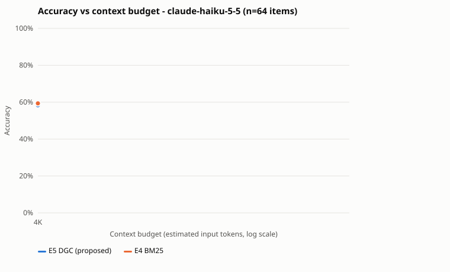
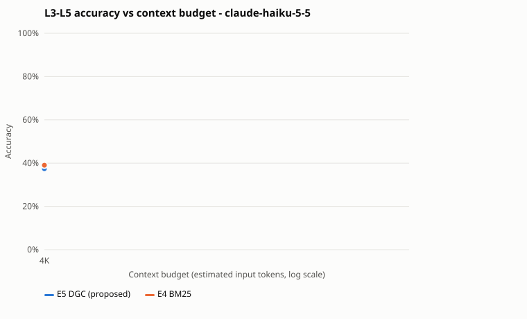
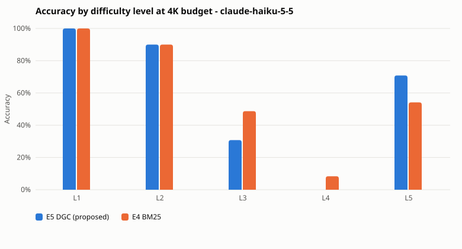
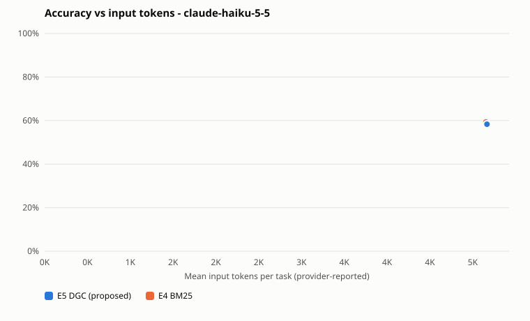

# Results - repeat_haiku-20261113-201949

- Created: 2026-11-13T20:19:49; dataset v1 (sha 5e550060fea81413); fixture 8da947b42b62564d; prompt p1; ccbench 1.0.0
- Providers (effective parameters): `{"claude-haiku-5-5": {"model": "haiku", "temperature": null, "seed": null, "unsupported": ["temperature", "seed"], "effort": null}}`
- Records: 384 (ok 384, errors 0); scored from raw responses with scorer s2

## Accuracy and cost per condition

| model | strategy | budget | n | acc % [95% CI] | L1 | L2 | L3 | L4 | L5 | ctx recall | evid. P | evid. R | est ctx tok | input tok | out tok | latency s | cost/task $ |
|---|---|---|---|---|---|---|---|---|---|---|---|---|---|---|---|---|---|
| claude-haiku-5-5 | bm25 | 4000 | 192 | 59.4 [52.3, 66.1] | 100.0 | 90.0 | 48.7 | 8.3 | 54.2 | 59.7 | 71.4 | 50.1 | 3949 | 5154 | 786 | 5.1 | 0.0006 |
| claude-haiku-5-5 | dgc | 4000 | 192 | 58.3 [51.3, 65.1] | 100.0 | 90.0 | 30.8 | 0.0 | 70.8 | 74.8 | 79.4 | 61.4 | 3945 | 5166 | 750 | 5.2 | 0.0005 |

## Pre-registered hypotheses

### claude-haiku-5-5

- **H1a_4000** - inconclusive: `{"comparison": "dgc - bm25 @4000, L3-L5", "n_items": 41, "acc_dgc": 0.374, "acc_bm25": 0.3902, "diff": -0.0163, "ci95": [-0.16260162601626016, 0.13008130081300814], "p_bootstrap": 0.8368, "mcnemar": [5, 6, 1.0], "p_holm": 0.8368}`
- **H2a** - not equivalent: `{"comparison": "acc(dgc | CR=1) - acc(bm25 | CR=1), pooled over budgets", "n_dgc_cr1": 84, "n_bm25_cr1": 60, "acc_dgc_cr1": 0.9643, "acc_bm25_cr1": 0.9667, "acc_dgc_cr_lt1": 0.287, "acc_bm25_cr_lt1": 0.4242, "diff": -0.0024, "ci90": [-0.050000000000000044, 0.050000000000000044], "margin": 0.05}`
- **H3b** - inconclusive: `{"comparison": "distractor-confusion rate on look-alike items, bm25 vs dgc @2K+4K", "rate_bm25": 0.0345, "rate_dgc": 0.0, "bm25_only": 3, "dgc_only": 0, "p_mcnemar": 0.25, "p_holm": 0.5}`

## Other diagnostics

```json
{
  "flip_rate": {
    "n_cells_with_repeats": 128,
    "flip_rate": 0.0546875
  },
  "token_calibration": {
    "claude-haiku-5-5": {
      "n": 384,
      "intercept_tokens": 75.73572002764104,
      "slope_actual_per_estimated": 1.0752959831797664
    }
  },
  "model_rank_agreement": {},
  "n_records": 384,
  "n_ok": 384,
  "n_errors": 0
}
```

## Charts





